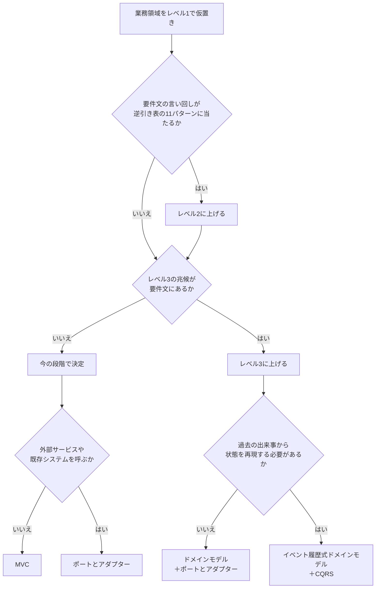

# 作り方の判定と業務の動作の整理

要件に必要な仕組みを、単純な方法から選ぶ。
判定は候補を絞るために使う。分類名や機能名だけで、上の段階を確定しない。
考え方の元は『ドメイン駆動設計をはじめよう』10 章の判定方法である。できるだけ単純な道具を選び、ドメインモデル、イベント履歴式、CQRS のような複雑な手段は本当に必要なときの最後の手段にする。このスキルでは、それを基本の技術構成に合わせて 3 段階にした。

## 作り方の判定

業務領域ごとに判定する。アプリ全体を 1 つの段階にそろえない。
既定はレベル1。上げる理由を要件文から引けるときだけ上げる。

| 段階 | 作り方 | 使う部品 |
|---|---|---|
| レベル1 | 基本の技術構成で素直に作る | 主体の型と、主体を受け取って確認・加工する関数。構成は MVC か、ポートとアダプター |
| レベル2 | レベル1に、厳選したデザインパターンを当てて疎結合にする | `gof-patterns.md` の逆引き表の 11 パターンから最大 3 件 |
| レベル3 | 複雑さが最初から見えている部分にだけ、DDD の部品を持ち込む | 集約、エンティティ、値オブジェクト、リポジトリ、ユースケース、業務イベント。必要ならイベント履歴式、CQRS、サーガ |

主体は、業務の中心となるデータを指す。ベルトコンベアで流れてきて、確認や加工を受けて完成品になる物にあたる。レベル3では、主体を集約として扱う。

### 判定の流れ

レベル2の兆候が無くても、レベル3の兆候は必ず確かめる。レベル3でも、逆引き表のパターンは使ってよい。

### レベル2に上げる兆候

要件文の言い回しが、`gof-patterns.md` の逆引き表の「言い回し／兆候」の行に当たるとき。
当たっても、if 文 2〜3 個や設定の表で素直に書けるなら上げない。例えば割引の段階があるだけでは State にしない。
表に無い 12 パターンが当たりそうなだけなら上げない。言語機能や素朴な書き方で済むので、レベル1のままにする。

### レベル3に上げる兆候

次のどれかを、要件文から引けるときだけ上げる。

| 要件で確認できること | 持ち込むもの |
|---|---|
| 複数のデータにまたがる決まりがあり、DB の一意制約や 1 回の更新だけでは守れない | 集約。決まりを 1 か所で守らせる |
| 状態ごとに操作の可否が変わり、例外や制約が絡み合う決まりが中核にある。State を当てても 1 つの主体に収まらない | ドメインモデル |
| 金銭処理・分析・監査のため、過去の出来事から状態や判断を再現する必要がある。現在の状態と変更履歴のテーブルでは足りない | イベント履歴式ドメインモデル。CQRS と組にする |
| 別々に確定する複数の業務を連係し、途中で失敗したら取り消しや代わりの処理が要る | サーガ。通知漏れを防ぐなら送信箱も |
| 更新と一覧・集計で必要な情報の形が大きく違い、集計用の読み取り関数を分けるだけでは足りない | CQRS |

次のことだけでは上げない。

- 項目数や画面数が多い
- 金額、監査、承認という言葉がある
- 中核の業務領域に分類した
- 将来複雑になるかもしれない
- 一緒に表示したいデータがある

### 複雑さの見分け方

| 観点 | 単純な場合 | 複雑な場合 |
|---|---|---|
| 入力と計算 | 必須項目の確認や決まった計算が中心 | 複数の業務条件が影響し合い、結果が変わる |
| 状態の変化 | 操作と結果の対応が明確 | 状態ごとに操作の可否が変わり、例外や制約が関係する |
| 情報の構造 | 少数の項目や独立した記録で足りる | 複数の関連や入れ子の情報を一緒に扱う |
| 言葉の説明 | 登録・表示・更新などで説明できる | 業務固有のルールや前提を説明しないと判断できない |

項目数が多いことだけを、業務ルールが複雑な理由にしない。

## 各段階の構成

基本の技術構成は Next.js（App Router）、Prisma、SQLite、Tailwind CSS 4 以上。その時点の最新安定版を使う。データの読み書きは Prisma を通し、SQL を直接書かない。

| 段階 | 構成 | 書き方 |
|---|---|---|
| レベル1・2 | MVC | 画面（page とコンポーネント）が View。Server Actions か Route Handler が Controller。Prisma のスキーマと、主体を受け取って確認・加工する関数が Model。関数は業務領域ごとのモジュールに置く。Controller はその関数を順に呼ぶだけにする |
| レベル1・2 | ポートとアダプター | MVC に加えて、外部サービスや既存システムの呼び出しをアダプターのモジュールに置く。業務の関数はこちらの型で受け取り、相手の形を知らない。差し替える予定の無い DB（Prisma）は、アダプターに包まず直接呼んでよい |
| レベル2 | 上に加えてパターン | 逆引き表で当たった箇所だけにパターンを当てる。当てない箇所はレベル1の書き方のまま |
| レベル3 | ドメインモデル＋ポートとアダプター | ユースケースが、リポジトリで集約を読み、集約の操作で決まりを守らせ、保存して業務イベントを知らせる。Prisma はリポジトリの中で使う |
| レベル3 | イベント履歴式ドメインモデル＋CQRS | `ddd-tactical.md` の「履歴から状態を再現する場合」に従う |

MVC とポートとアダプターのどちらにするかは、`technique-fit.md` のクリーンアーキテクチャの行で判断する。業務の関数が DB や外部の形に依存して壊れる兆候が無ければ MVC のままにする。
レベル3の部品も、`../SKILL.md` の「構成要素の粒度」と「値オブジェクトの採用」に従い、要件が固まった部分だけに使う。
層の数やディレクトリの形を先に固定しない。すべての境界に専用インタフェースを作ることを条件にしない。

### トランザクションスクリプトにしない

どの段階でも、トランザクションスクリプトは使わない。
見分け方は、Server Actions や Route Handler の 1 つの関数に、入力確認・計算・保存・通知が上から並んでいるかどうか。並んでいたら、主体を受け取って確認・加工する関数に切り出し、Controller には呼ぶ順番だけを残す。

### 業務分類との突き合わせ

| 判断の組み合わせ | 確認すること |
|---|---|
| 中核なのにレベル1 | 差別化を生むのはどこか。業務ルールを読み落としていないか。中核でもレベル1で足りることはある |
| 補完・一般なのにレベル3 | 未確認の条件があるか。分類や業務の分け方が適切か |
| 一般なのに大幅な自前実装が必要 | 既製品が満たせない具体的な条件は何か |

食い違いは確定させず質問にする。分類に合わせるために段階を上げない。

## 別サーバーを立てる判断

既定は Next.js 1 つで作る。次のどれかを要件文から引けるときだけ、別サーバーを候補にする。

| 要件で確認できること | 候補 |
|---|---|
| Python にしか良い道具が無い処理がある。機械学習、データ分析など | FastAPI |
| 画面の操作と切り離して動く処理がある。定期実行、キューで順に流す処理、時間のかかる処理 | Hono。Python の道具が要るなら FastAPI |
| 画面以外の利用者が同じ業務の処理を呼ぶ。スマホアプリ、外部に公開する API、他システム | Hono |
| 常時接続で双方向にやりとりする。WebSocket など | Hono |

TypeScript の Hono を先に考える。Next.js と型を共有でき、Prisma もそのまま使えるから。
別サーバーを立てるときは、DB をどちらが持つかを「決めてもらうこと」に回す。
Next.js の中で書けるものを、将来のために先に分けない。段階がレベル3になったことだけでは、別サーバーを立てない。

## 必要な動作の整理

出来事を手がかりに、誰の操作で何が変わり、どの業務へ伝わるかを整理する。これをイベントストーミングと呼ぶ。
要件文を材料に行い、実際に関係者と確認した結果と、こちらの仮置きを区別する。

| 種類 | 書き方 | 確認すること |
|---|---|---|
| 登場人物 | 業務での役割名 | 誰が操作や判断をするか |
| 外部システム | 要件に登場するシステム名 | 入力する側か、結果を受け取る側か |
| コマンド | 「〜する」 | 何を指示し、誰や何が実行するか |
| 業務イベント | 「〜された」 | 何が確定した出来事か |
| ポリシー | 「〜されたら〜する」 | 出来事を受けて自動的に何を行うか |

### 要件文から整理する手順

1. 対象とする業務と、達成したい結果を確認する。
2. 要件にある出来事を過去形で書き出す。
3. 通常の進み方を時系列に並べ、要件にある分岐や失敗時の動きを添える。
4. 順序、担当者、条件が不明な箇所を、未確認の点として残す。
5. 各出来事を起こす操作を「〜する」で書き、その操作を行う人や外部システムを対応付ける。
6. 出来事を受けて自動実行される操作があれば、ポリシーとして対応付ける。
7. 操作を判断するために必要な情報があれば、何を見るかを確認する。
8. 外部システムとの入力と通知を整理する。
9. 操作と出来事の対象を主体の候補にまとめ、守る決まりを確認する。レベル3の業務領域では、守る決まりから集約の境界を確認する。
10. 同じ言葉の意味と担当範囲を確かめる。レベル3の業務領域では、文脈の境界と突き合わせる。

各コマンドを誰や何が実行するか分からなければ、未確認と書く。要件にない操作、通知先、承認者を補って確定しない。
業務の切れ目は文脈を探す手がかりになるが、工程が変わるたびに別の文脈にしない。
単純な業務は要件に書かれた動作を表に整理すればよい。手順を満たすために動作を増やさない。

### 出力への反映

必要な動作は `../assets/output-template.md` の1つの表にまとめる。
主体、業務領域、通知先が全体図と対応しているか確認する。動作の表には「何が変わるか」を短い1文で書く。
この段階では、各クラスや関数の入力・加工・出力を定める表は必須にしない。具体的な処理分割が必要になったときに詰める。

## 既存システムを整理する場合

現在の画面、コード、データ、業務の説明のうち、依頼に必要なものを確認してから現状を書く。
既存のフォルダ名やサービス名が、そのまま業務や文脈の境界とは限らない。

| 観察すること | 設計で確認すること |
|---|---|
| 同じ言葉が場所ごとに違う意味で使われる | 別の文脈に分ける必要があるか |
| 1つの業務変更で多数の場所を直す | 密接に関係する仕事を分断していないか |
| 相手のデータ形式を業務の各所で意識する | 受け渡しの部分で変換できるか |
| 業務ルールが複数の場所にある | 同じ決まりが重複していないか、管理する場所はどこか |
| 構造が複雑だが業務の理由が分からない | 業務担当者に具体的な操作や例外を確認できるか |

現状と提案を区別し、依頼に含まれない全面的な書き換えやサービス分割を提案の前提にしない。

## 設計結果の確認

- 業務の目的と、中心となる情報が対応しているか。
- 図、用語、動作、主体、テーブルの名前と関係がそろっているか。
- 守る決まりを守る保存方法を説明できるか。
- 分類と段階を、要件に基づいて説明できるか。上げた段階ごとに、根拠の言い回しを引けるか。
- 持ち込んだ技法ごとに、`technique-fit.md` の「解決したい問題」を要件文から引けるか。「相応しくない状況」に当たる業務領域に持ち込んでいないか。
- 必要な理由のない部品やパターンを足していないか。レベル1・2の業務領域に DDD の部品が入っていないか。
- 未確認の判断に「（仮）」があり、答えによって設計が変わる質問に絞れているか。

要件が不明瞭でテストから先に書く業務領域は、`technique-fit.md` のテスト駆動開発の扱いに従う。
実装時の確認方法を求められた場合は、レベル1・2では受付から保存までの動き、レベル3では個々の決まりと同時更新、イベント履歴式では状態の再現を検証対象にする。
