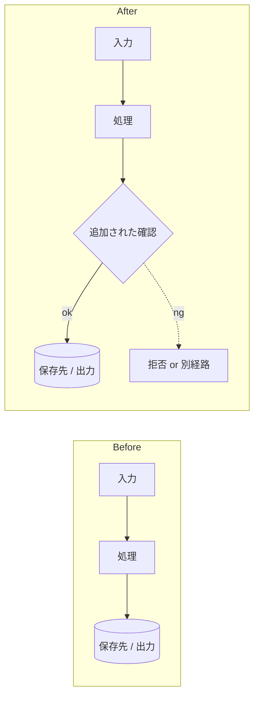

# Before / After エビデンスの雛形（issue-loop Step 4-7）

実装後に issue や PR へコメントするとき、「変更前 → 変更後」を一目で分かるようにするための雛形。書き方そのものは `issue-comment-style` スキルに従う。

## いつ何を使うか

- **UI 系**（画面の見た目・配置・文言が変わる）→ **Before/After のスクショを合計 2 枚程度**貼る。要点だけが収まるサイズにする。文章の説明は最小限
- **データ系**（AI の出力・保存される値・API のレスポンスが変わる）→ **Mermaid のフロー図＋実データの抜粋**を貼る。フロー図でどこが変わったかを 1 枚で示し、実データは「入力 → 旧出力」「入力 → 新出力」を 5〜10 行ずつ並べる
- **両方変わる** → スクショと Mermaid を 1 コメントに同居させる

画像は `gh attach` で上げる。

```bash
gh attach upload before.png after.png \
  --target <owner>/<repo>#<N> --strategy release-asset --format markdown
```

## Mermaid 雛形（データ系）



書き方のルール：

- `subgraph Before` / `subgraph After` を横並びにする（`flowchart LR`）。縦並びは比べにくい
- 実線は正常な流れ 1 本だけ。例外・拒否・スキップは点線で書く
- ノードは `[ラベル]` で揃える。保存先・最終出力だけ `[(...)]` を使ってよい
- 色や装飾は付けない
- ラベルは日本語の普通の言葉にする。関数名やテーブル名は使わない

## やってはいけないこと

- Before と After を別々のコメントに分ける
- 差分を文章だけで説明する
- コードの差分（`git diff`）をそのまま貼る
- ゴールを満たしていないのにエビデンスを貼って PR を出す。満たしていなければ相談コメントにする
